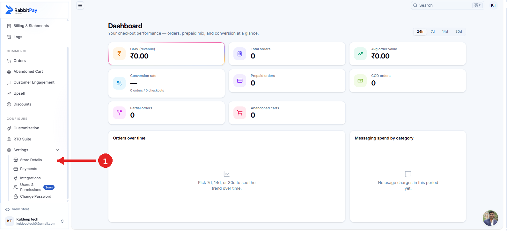
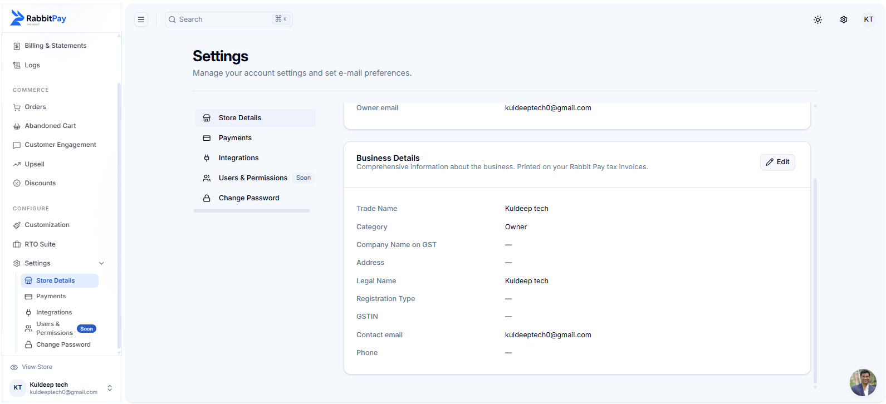
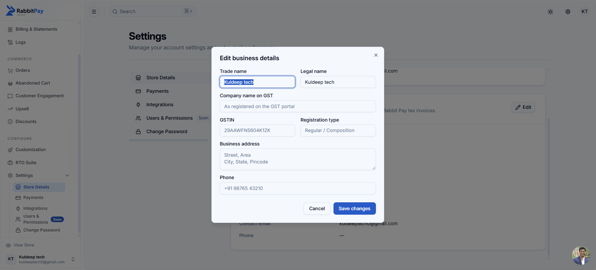

RabbitPay allows merchants to add their **GSTIN and business details** directly from the RabbitPay Dashboard.

Once your GSTIN is saved, your registered business information can be used for billing and GST-related invoices for your Shopify app fees.

## Prerequisites

Before you begin, make sure you have:

- An active **RabbitPay merchant account**
- Your valid **GSTIN**
- Your registered business details as shown on the GST portal

---

## Step 1: Open Store Details

1. Log in to your **RabbitPay Dashboard**.
2. In the left sidebar, expand **Settings**.
3. Select **Store Details**.

<Frame caption="Open Settings → Store Details from the RabbitPay Dashboard.">
  
</Frame>

<Note>
  Store Details is where you can manage your business information used for RabbitPay billing and invoices.
</Note>

---

## Step 2: Edit Your Business Details

On the **Store Details** page, find the **Business Details** section.

Click **Edit** to update your business information.

<Frame caption="Business Details section in RabbitPay Store Details.">
  
</Frame>

---

## Step 3: Add Your GSTIN

In the **Edit business details** window, enter your registered business information.

Fill in the relevant fields:

- **Trade name** — Your business or store trade name.
- **Legal name** — The legal name of your business.
- **Company name on GST** — Enter the name registered on the GST portal.
- **GSTIN** — Enter your valid 15-character GSTIN.
- **Registration type** — Select the applicable GST registration type.
- **Business address** — Enter your registered business address.
- **Phone** — Enter your business contact number.

<Frame caption="Enter your GSTIN and registered business details.">
  
</Frame>

<Warning>
  Make sure your GSTIN and registered business information match the details available on the GST portal.
</Warning>

---

## Step 4: Save Your Details

After entering the required information:

1. Review your GSTIN and business details.
2. Click **Save changes**.
3. RabbitPay will update your business information.

<Check>
  Your GSTIN has been added successfully when it appears in the **Business Details** section.
</Check>

---

## What This Enables

Adding your GSTIN helps RabbitPay associate your registered business information with your account billing details.

<CardGroup cols={2}>
  <Card title="GSTIN on Account" icon="file-invoice">
    Keep your GST registration details associated with your RabbitPay merchant account.
  </Card>

  <Card title="Accurate Business Details" icon="building">
    Maintain your registered trade name, legal name, GSTIN, address, and contact information in one place.
  </Card>

  <Card title="Billing Information" icon="receipt">
    Your saved business details can be used for billing and invoice-related information for RabbitPay services.
  </Card>

  <Card title="Easy Updates" icon="pen">
    Update your business details whenever your registered information changes.
  </Card>
</CardGroup>

---

## Result

Your GSTIN and business details are now saved in RabbitPay.

You can return to:

**Settings → Store Details → Business Details**

to review the information at any time.

<Note>
  Always keep your GSTIN and registered business information accurate and up to date.
</Note>