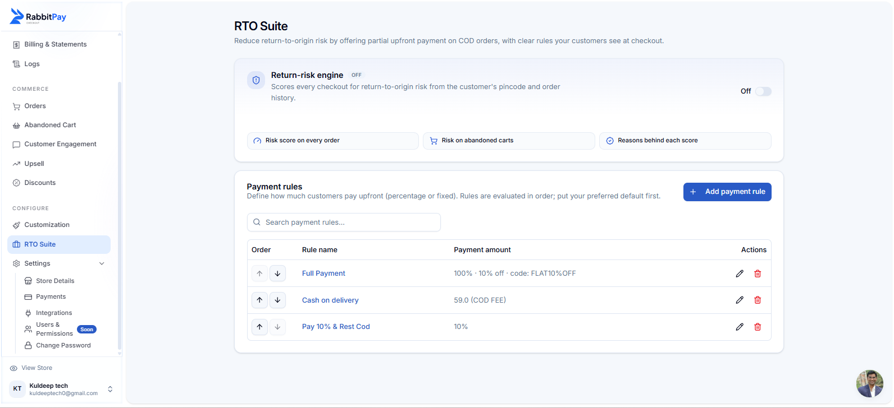

RabbitPay lets you control the **order in which your payment options are evaluated and shown at checkout**.

You can change the priority of your payment rules directly from **RTO Suite** using the **↑** and **↓** buttons.

The rule placed higher in the list gets higher priority.

## Where to Find Payment Rules

1. Log in to your **RabbitPay Dashboard**.
2. Open **RTO Suite** from the left sidebar.
3. Scroll to the **Payment rules** section.

<Frame caption="Payment rules in RabbitPay RTO Suite.">
  
</Frame>

---

## How Payment Rule Priority Works

Each payment rule has two controls:

- **↑ Up** — Move the rule higher in the list and give it higher priority.
- **↓ Down** — Move the rule lower in the list and give it lower priority.

RabbitPay evaluates the payment rules **from top to bottom**.

<Note>
  The rule at the top has the highest priority. Rules below it are evaluated after the rules above them.
</Note>

---

## Step 1: Move a Payment Option Up

If you want a payment option to have higher priority:

1. Find the payment rule you want to prioritize.
2. Click the **↑ Up** button.
3. The rule moves one position higher.
4. Continue clicking **↑** until it reaches the position you want.

For example, if **Full Payment** is moved above **Cash on delivery**, Full Payment gets higher priority.

---

## Step 2: Move a Payment Option Down

If you want a payment option to have lower priority:

1. Find the payment rule you want to move down.
2. Click the **↓ Down** button.
3. The rule moves one position lower.
4. Continue clicking **↓** until it reaches the required position.

<Warning>
  Changing the order of payment rules can change which payment option is prioritized for eligible customers at checkout.
</Warning>

---

## Example

Suppose your payment rules are arranged like this:

| Priority | Payment rule |
| --- | --- |
| 1 | Full Payment |
| 2 | Cash on delivery |
| 3 | Pay 10% & Rest COD |

Here, **Full Payment** has the highest priority because it is at the top.

If you move **Cash on delivery** above **Full Payment**, the order becomes:

| Priority | Payment rule |
| --- | --- |
| 1 | Cash on delivery |
| 2 | Full Payment |
| 3 | Pay 10% & Rest COD |

The payment rules are now evaluated in this new order.

---

## Step 3: Save Your Changes

After arranging the payment rules:

1. Review the order of your rules.
2. Make sure the preferred rule is at the top.
3. Save the changes if RabbitPay displays the save option.
4. Test your Shopify checkout to verify the result.

<Check>
  Your payment-rule priority is updated successfully when the rules appear in your preferred order in RTO Suite.
</Check>

---

## Result at Shopify Checkout

The priority you configure in RabbitPay determines how eligible payment options are presented through the checkout flow.

For example, if **Full Payment** is placed above **Cash on delivery**, customers eligible for both options will see the prepaid option prioritized accordingly.

---

## Why Control Payment Option Priority?

<CardGroup cols={2}>
  <Card title="Promote Prepaid Payments" icon="credit-card">
    Place your full-payment rule higher to prioritize prepaid orders and encourage customers to pay online.
  </Card>

  <Card title="Reduce COD Risk" icon="shield-check">
    Give prepaid or partial-payment rules higher priority to reduce dependency on cash-on-delivery orders.
  </Card>

  <Card title="Flexible Payment Strategy" icon="sliders-horizontal">
    Arrange payment rules based on your store's payment and RTO strategy.
  </Card>

  <Card title="Simple Rule Management" icon="arrow-up-down">
    Change payment priority directly from RTO Suite without modifying your Shopify theme.
  </Card>
</CardGroup>

---

## Quick Summary

**↑ Move Up**

Higher position → Higher priority → Evaluated earlier.

**↓ Move Down**

Lower position → Lower priority → Evaluated later.

<Note>
  Keep your preferred default payment rule at the top of the list so it receives the highest priority.
</Note>