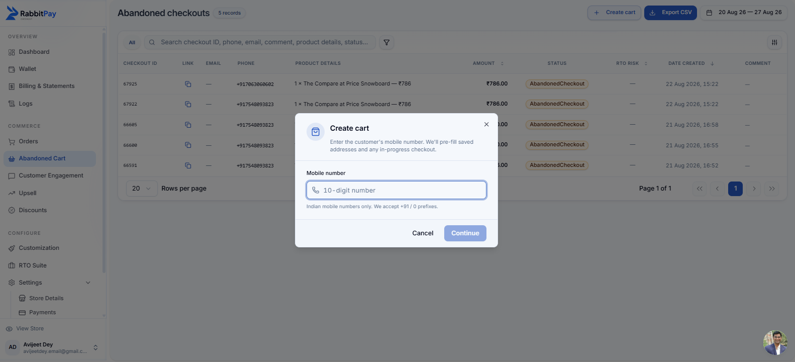
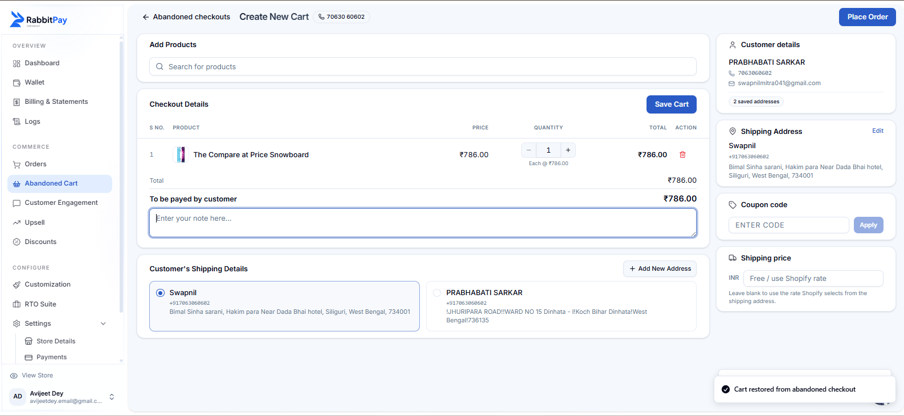
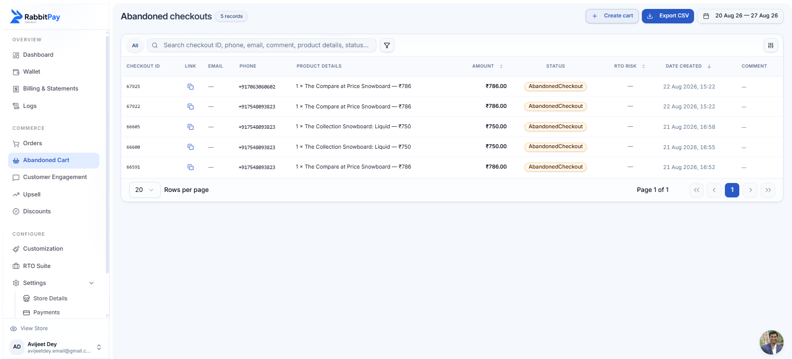
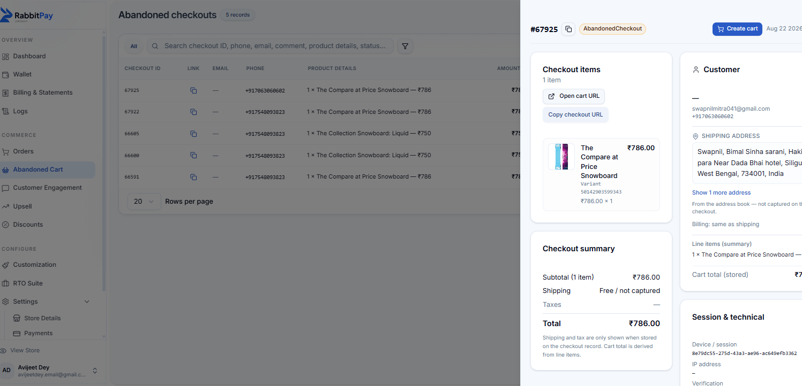

RabbitPay lets merchants create a cart for a customer in two ways:

- Create a **new cart directly** using the customer's mobile number.
- Restore a cart from an **existing abandoned checkout**.

This is useful when a customer contacts your support team and needs help completing their purchase.

## Option 1: Create a New Cart Using a Mobile Number

You can create a new cart directly from the **Abandoned Cart** page.

### Step 1: Open Abandoned Cart

1. Log in to your **RabbitPay Dashboard**.
2. Select **Abandoned Cart** from the left navigation.
3. Click **Create cart** in the top-right corner.

<Frame caption="Create a new cart from the Abandoned Cart page.">
  
</Frame>

### Step 2: Enter the Customer's Mobile Number

The **Create cart** dialog will appear.

1. Enter the customer's mobile number.
2. Click **Continue**.

RabbitPay uses the mobile number to retrieve available customer information, including saved addresses and any in-progress checkout.

<Frame caption="Enter the customer's mobile number to create a cart.">
  
</Frame>

<Note>
  RabbitPay accepts Indian mobile numbers with a \+91 or 0 prefix.
</Note>

---

## Create New Cart

After entering the customer's mobile number, RabbitPay opens the **Create New Cart** page.

This page allows the merchant to build and configure the customer's order before placing it.

<Frame caption="Create New Cart page with products, customer details, shipping address, coupon, and shipping options.">
  
</Frame>

### Add Products

Use the **Search for products** field to find and add products to the cart.

Once a product is added, you can review:

- Product name
- Price
- Quantity
- Total amount

You can also increase or decrease the product quantity or remove a product from the cart.

### Checkout Details

The **Checkout Details** section shows the products currently added to the cart.

You can review the order total before saving or placing the order.

You can also add a **note** for the order using the note field.

### Customer Details

The **Customer details** section displays the customer's available information, including:

- Customer name
- Mobile number
- Email address
- Number of saved addresses

RabbitPay retrieves this information using the customer's mobile number.

### Shipping Address

The merchant can select the customer's available shipping address.

If the customer has multiple saved addresses, select the appropriate address for the order.

You can also:

- **Edit** an existing address.
- **Add New Address** if the required address is not already saved.

### Coupon Code

Merchants can apply a discount to the cart using the **Coupon code** field.

1. Enter the customer's coupon code.
2. Click **Apply**.
3. The applicable discount is reflected in the order total.

### Shipping Price

Merchants can configure the shipping charge for the order.

Enter a shipping amount in the **Shipping price** field.

You can also leave the field blank to use the shipping rate selected by Shopify for the customer's shipping address.

<Note>
  Shipping rates depend on the shipping configuration available for the Shopify store.
</Note>

---

## Save or Place the Order

After reviewing the cart details, customer information, shipping address, and pricing:

- Select **Save Cart** to save the cart for later.
- Select **Place Order** to proceed with the order.

RabbitPay confirms when the cart has been successfully restored or created.

---

## Option 2: Create a Cart from an Existing Abandoned Checkout

If the customer already has an abandoned checkout, you can create a cart directly from that checkout.

### Step 1: Open the Abandoned Checkout

1. Go to **Abandoned Cart**.
2. Find the customer's abandoned checkout.
3. Click the checkout to open its details.

<Frame caption="Abandoned checkouts available in RabbitPay.">
  
</Frame>

### Step 2: Select Create Cart

The checkout details panel displays the customer's information, products, and checkout total.

Click **Create cart**.

<Frame caption="Create a cart directly from an abandoned checkout.">
  
</Frame>

RabbitPay restores the available checkout information and opens the **Create New Cart** page.

You can then review or modify the cart before saving or placing the order.

---

## What Can Merchants Configure?

When creating a cart, merchants can manage the main order details from a single page:

<CardGroup cols={2}>
  <Card title="Products" icon="package">
    Add products, change quantities, review prices, or remove products from the cart.
  </Card>

  <Card title="Customer Information" icon="user">
    Review the customer's name, phone number, email address, and saved information.
  </Card>

  <Card title="Shipping Address" icon="map-pin">
    Select a saved address, edit an address, or add a new shipping address.
  </Card>

  <Card title="Coupon Code" icon="tag">
    Apply an eligible coupon code to the customer's cart.
  </Card>

  <Card title="Shipping Price" icon="truck">
    Add a shipping charge or use the shipping rate configured in Shopify.
  </Card>

  <Card title="Order Note" icon="file-text">
    Add an internal note or additional information related to the order.
  </Card>
</CardGroup>

## Why Use Create Cart?

<CardGroup cols={2}>
  <Card title="Support-Assisted Ordering" icon="headphones">
    Help customers complete their purchase when they need assistance during checkout.
  </Card>

  <Card title="Recover Abandoned Purchases" icon="refresh-cw">
    Restore abandoned checkout information instead of rebuilding the order manually.
  </Card>

  <Card title="Faster Order Creation" icon="zap">
    Create and configure a customer's cart from the RabbitPay Dashboard.
  </Card>

  <Card title="Flexible Cart Management" icon="settings">
    Modify products, quantities, addresses, coupons, shipping, and notes before placing the order.
  </Card>
</CardGroup>

## Result

RabbitPay gives merchants a complete support-assisted ordering flow:

**Abandoned Cart → Create cart → Customer mobile number → Create New Cart**

or

**Abandoned Cart → Open abandoned checkout → Create cart → Create New Cart**

From the **Create New Cart** page, merchants can review and configure the order before saving the cart or placing the order.