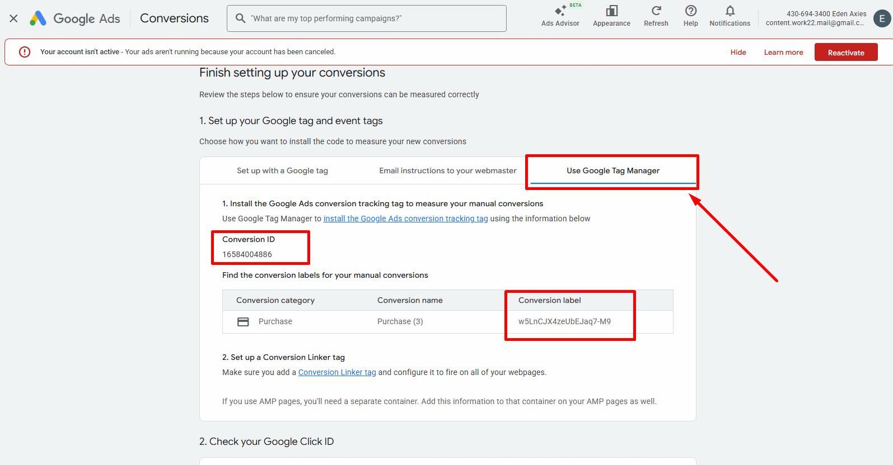
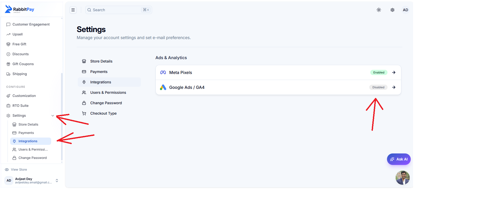
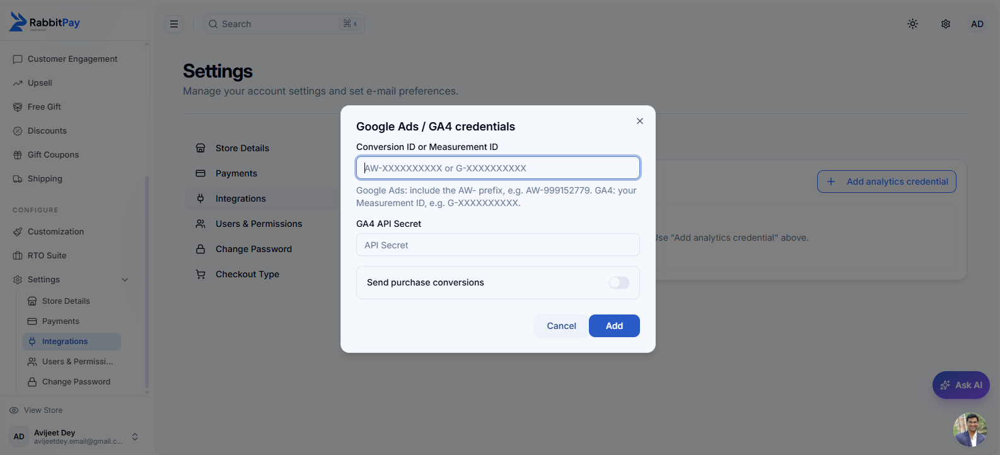

RabbitPay allows you to connect Google Ads and Google Analytics 4 (GA4) to track purchase conversions and collect checkout analytics.

Follow the steps below to find your credentials and configure the integration.

## Google Ads Conversion ID

The Google Ads Conversion ID is required to track purchase conversions through Google Ads.

### Step 1: Open Google Ads

1. Visit [Google Ads](https://ads.google.com/).
2. Sign in using your Google Ads account.
3. Select the correct advertising account.

### Step 2: Open the Conversions Section

1. Click **Goals** in the left-hand navigation menu.
2. Navigate to **Conversions → Summary**.
3. Select your **Purchase** conversion action.

### Step 3: Open Tag Setup

1. Open the selected Purchase conversion action.
2. Find the **Tag setup** section.
3. Select **Use Google Tag Manager**.

### Step 4: Copy the Conversion ID

You will find your Conversion ID displayed on the screen.

Copy the Conversion ID, including the `AW-` prefix.

Example: `AW-999152779`

<Note>
  RabbitPay requires the Google Ads Conversion ID. The Conversion Label is not a separate field in the current RabbitPay integration.
</Note>

## Google Analytics 4 (GA4) Credentials

To connect Google Analytics 4, you need two values:

- Measurement ID
- API Secret

<Frame>
  
</Frame>

### Step 1: Find Your Measurement ID

1. Open [Google Analytics](https://analytics.google.com/).
2. Select your GA4 property.
3. Navigate to **Admin → Data Streams**.
4. Select your website data stream.
5. Find and copy the **Measurement ID**.

Example: `G-XXXXXXXXXX`

### Step 2: Generate Your GA4 API Secret

1. Open your website data stream under **Admin → Data Streams**.
2. Find the **Measurement Protocol API secrets** section.
3. Open the section.
4. Click **Create** to generate a new API secret.
5. Enter a nickname and save it.
6. Copy the generated API Secret.

<Warning>
  Keep your API Secret confidential. Do not share it publicly or expose it in frontend code.
</Warning>

## Add Credentials to RabbitPay

After collecting the required details:

1. Open your Shopify Admin.
2. Launch the RabbitPay app.
3. Navigate to **Settings → Integrations**.
4. Click **Add analytics credential**.
5. Enter the following details:

<Frame>
  
</Frame>

| Field | Information |
| --- | --- |
| Conversion ID or Measurement ID | Google Ads Conversion ID (`AW-...`) or GA4 Measurement ID (`G-...`) |
| GA4 API Secret | Your GA4 API Secret |

<Frame>
  
</Frame>

6. Enable **Send purchase conversions** if you want RabbitPay to send purchase conversion events.
7. Click **Add** to save your credentials.

## Important Notes

- Use the `AW-` prefix when entering your Google Ads Conversion ID.
- Use the `G-` prefix when entering your GA4 Measurement ID.
- The GA4 API Secret is required for GA4 Measurement Protocol tracking.
- Do not share your Google account password or login credentials.
- Make sure you enter the credentials belonging to the correct Google Ads account or GA4 property.

Your Google Ads and GA4 credentials are now configured in RabbitPay.
